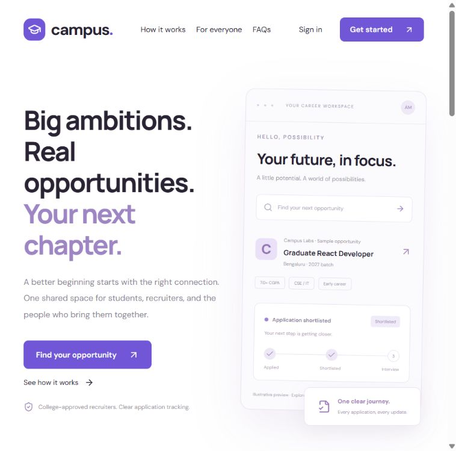
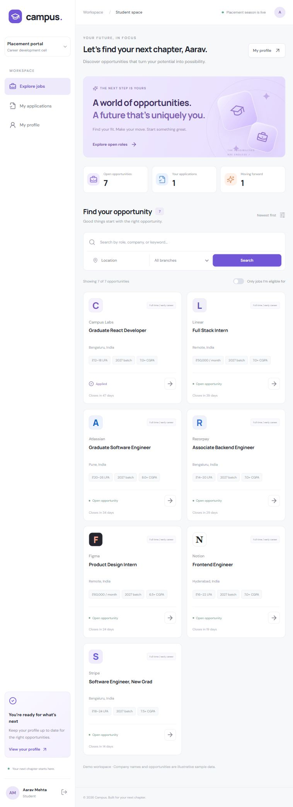
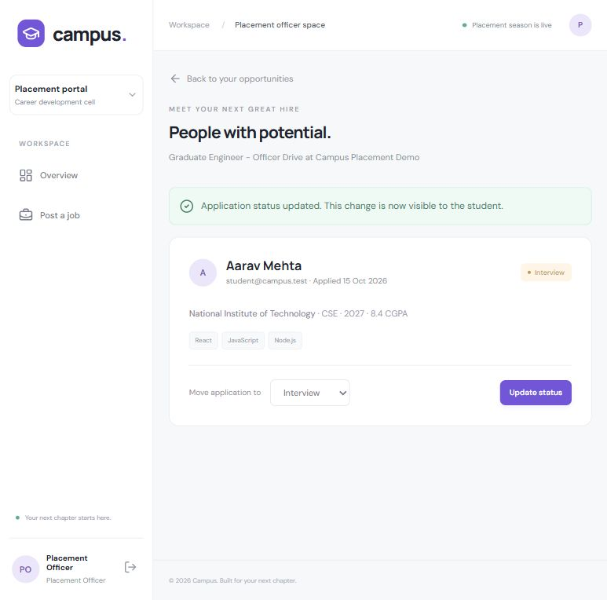
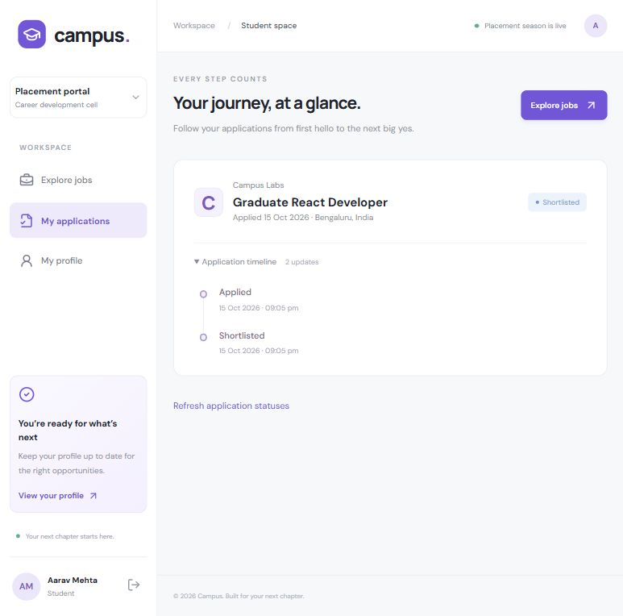
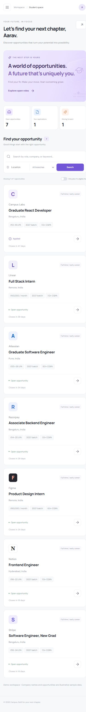

# Campus — College Placement Portal

Campus is a college placement website that connects students, placement officers, recruiters, and administrators in one workspace. Placement officers publish company opportunities, students discover roles that match their academic profile and apply, and the owning officer or recruiter manages applicants through the hiring process. Students can follow each application through a dated status history.

Built with **React + Vite**, **Express/Node.js**, and **MongoDB**, the portal includes a responsive landing page, student profiles, searchable opportunities, application tracking, staff dashboards, and admin controls. Role-based permissions, recruiter approval, eligibility checks, job ownership, and duplicate-application prevention are enforced by the API.

### Website preview



### Main features

- **Students:** maintain their academic profile, filter eligible jobs, apply once per opportunity, and track application progress.
- **Placement officers:** post company placement drives, edit their opportunities, review applicants, and update application statuses.
- **Recruiters:** publish jobs and manage their own applicants after admin approval.
- **Administrators:** approve recruiters, assign or revoke placement officer access, manage accounts, and archive job posts.
- **Protected workflow:** password hashing, HTTP-only cookie sessions, CSRF protection, server-side validation, and MongoDB uniqueness constraints.

**Placement flow:** officer posts a company opportunity → eligible student applies → officer reviews the application → student tracks the status update.

The recruiter onboarding flow is also supported:

**register → admin approves recruiter → recruiter posts a job → student completes profile → student applies → recruiter changes status → student sees the history**.

## Run locally

Requires Node.js 22+ and npm. From this folder:

```powershell
npm install
Copy-Item server/.env.example server/.env
```

Set a random `SESSION_SECRET` of at least 32 characters in **server/.env**. Never commit this file. Generate a value with `node -e "console.log(require('node:crypto').randomBytes(48).toString('base64'))"` and place it in that file.

Set `MONGODB_URI=mongodb://127.0.0.1:27017/placement_portal` to use a local service. If MongoDB is not installed, either use Docker (`docker compose up -d`) or run the included development MongoDB launcher in a separate terminal:

```powershell
npm run db
```

The development launcher downloads the **official MongoDB 7.0.14 binary** on first use (around 600 MB on Windows), starts a real MongoDB process bound to localhost, and persists data in `.data/mongodb`. It is a development convenience, not a production database service. Do not start it if port 27017 already has MongoDB running. Stop it with Ctrl+C; data persists across restarts.

Then:

```powershell
npm run seed
npm run dev
```

Open **http://127.0.0.1:5175** (use 127.0.0.1 consistently rather than mixing it with localhost).

The client proxies `/api` to Express at `127.0.0.1:4000`. No browser-stored tokens or repeated API configuration are used. `client/src/services/api.js` owns cookies, CSRF headers, JSON, and error handling.

## Demo accounts

| Role | Email | Password |
| --- | --- | --- |
| Student | student@campus.test | PlacementDemo!2026 |
| Approved recruiter | recruiter@campus.test | PlacementDemo!2026 |
| Admin | admin@campus.test | PlacementDemo!2026 |
| Pending recruiter | pending@campus.test | PlacementDemo!2026 |
| Placement officer | placement_officer@campus.test | PlacementDemo!2026 |

Use the demo sign-in buttons or enter these values normally. Seeded company names, positions, and salaries are **illustrative data**, not real recruitment offers. The seed is non-destructive: it only inserts missing users, profile, and jobs. It does not reset passwords, approvals, edited jobs, or applications. Production seeding is disabled. New admin accounts cannot be created through registration; provision them through trusted database administration.

## Walk through the milestone

1. Register a recruiter at `/register`; registration always creates it pending approval.
2. In another browser session, sign in as the seeded admin. Approve the new recruiter under **Recruiter approvals**.
3. Sign in as that recruiter (or use **Check approval status**). Post a role with branch, CGPA, graduation year, and a future deadline.
4. Sign in as the student or register a new student. Save the academic profile, including at least one skill. The sample student has CSE, 2027, and CGPA 8.4.
5. Browse/search jobs. Turn on **Only jobs I'm eligible for**, open the new role, and apply.
6. As the job's recruiter, open **Applicants**, choose `shortlisted`, and click **Update status**.
7. As the student, open **My applications** (or click **Refresh application statuses**). The current status and dated timeline include the recruiter’s change. A page refresh or navigation retrieves fresh server data; live push updates are not included.

## Data model

| Collection | Fields and constraints |
| --- | --- |
| User | name, normalized unique email, bcrypt passwordHash (excluded from queries by default), role, isApproved, isActive, timestamps |
| StudentProfile | unique userId → User, college, uppercase branch, graduationYear, CGPA 0–10, skills, optional HTTPS resumeUrl |
| Job | recruiterId → User, company, title, description, location, salary text, allowedBranches, minimumCgpa, graduationYear, deadline, isActive, timestamps |
| Application | jobId → Job, studentId → User, status, appliedAt, append-only statusHistory entries: status, changedAt, changedBy |

MongoDB has a **unique compound index `{jobId: 1, studentId: 1}`**. Startup waits for indexes before accepting traffic. Duplicate submissions, including concurrent requests, return HTTP 409. Profile user IDs, job owner IDs, and application student IDs come from the server session, never the request body.

## API

All non-GET requests require an `X-CSRF-Token` obtained from `GET /api/auth/csrf` and JSON content. Keep cookies across requests. The client handles this automatically.

| Endpoint | Access / purpose |
| --- | --- |
| POST /api/auth/register | Public, validated student/recruiter only |
| POST /api/auth/login | Public, rate limited, rotates session |
| GET /api/auth/me | Signed-in active user + own student profile |
| POST /api/auth/logout | Destroys server session |
| PUT /api/students/me | Student, validated own profile |
| GET /api/jobs | Signed-in user; search, location, branch, eligible, mine, page, limit |
| GET /api/jobs/:id | Signed-in user; includes own eligibility/application |
| POST /api/jobs | Approved recruiter only |
| PUT /api/jobs/:id | Approved owner only |
| POST /api/jobs/:id/applications | Student; checks profile, deadline, branch, CGPA, year |
| GET /api/students/me/applications | Student; own applications + job summaries/history |
| GET /api/jobs/:id/applications | Approved recruiter owning that job; applicants + profiles |
| PATCH /api/applications/:id/status | Approved job owner; validated status + server-generated history |
| GET /api/admin/recruiters | Admin; review recruiter accounts |
| PATCH /api/admin/recruiters/:id/approval | Admin; approve/revoke |
| GET /api/admin/users | Admin; review users |
| PATCH /api/admin/users/:id | Admin; activate/deactivate non-admin users |
| GET /api/admin/jobs | Admin; review all posts |
| PATCH /api/admin/jobs/:id | Admin; archive/restore posts |
| GET /api/health | Public; database readiness |

Search escapes regular-expression characters. Pagination is bounded to 50 jobs per page. Student job browsing excludes archived/expired roles, and eligibility filters run on MongoDB fields. Admin lists are capped at the latest 200 entries; add server pagination if this demo grows beyond that size. Recruiter overview loads the first 50 owned roles.

Statuses: `applied`, `shortlisted`, `interview`, `selected`, `rejected`. Recruiters may move to any of these statuses; the server records each change with actor and time. Repeating the same status does not append another history entry.

## Permission and security checks

- Passwords are hashed with bcrypt (cost 12); password input is limited to 72 UTF-8 bytes to avoid truncation. No plaintext passwords are stored.
- Authentication uses signed, opaque session IDs in HTTP-only, SameSite=Strict cookies. The actual session is in MongoDB, with an eight-hour lifetime. Login/registration rotates the session. Logout destroys it.
- In production (`NODE_ENV=production`) cookies require HTTPS with `Secure`. Local HTTP development disables Secure only so localhost works. Production must use HTTPS and the same public origin for client and API.
- CSRF token and exact origin checks protect writes. Client and API run under one origin; permissive CORS is not enabled.
- Authentication reloads the active user on every request. User deactivation and recruiter approval revocation therefore affect existing sessions on their next protected request.
- Recruiter-only writes and applicant access require approval. Every applicant read/status update verifies the recruiter owns the referenced job. Another recruiter receives 404; changing URL IDs does not bypass the check.
- Student apply checks deadline and job availability, loads the server-side profile, and verifies branch, CGPA, and graduation year before inserting.
- Zod rejects unknown fields, invalid IDs, invalid bodies, invalid query parameters, and non-HTTPS resume links. React renders descriptions as text, not HTML.
- Helmet headers, request-size limits, auth rate limits, generic login errors, and API no-store headers are enabled.
- Admins can disable accounts and archive posts without deleting application history. Admins cannot disable themselves or other admin accounts from the UI.

## Verification

```powershell
npm test
npm run build
```

Tests use a real, isolated MongoDB test instance via mongodb-memory-server. They do not touch the development database. Tests cover authentication/CSRF, public role escalation rejection, recruiter approval, student write rejection, profile validation, backend CGPA/branch/year checks, concurrent duplicate applications and the database index, recruiter ownership, status/history visibility, expired/archived jobs, filters/pagination, deactivation/revocation, cookie flags, and logout.

## Production

```powershell
npm run build
$env:NODE_ENV='production'
npm start
```

Set `MONGODB_URI`, a strong `SESSION_SECRET`, `CLIENT_ORIGIN=https://your-domain.example`, `PORT`, and (only behind a trusted one-hop proxy) `TRUST_PROXY=true` in the server environment. Express serves `client/dist` and the API under the same origin. The server binds to 127.0.0.1 for a local reverse proxy; adapt the bind address only to your hosting/network setup. Use a supported MongoDB service with authentication, backups, and access restrictions.

The previous Axion Studio URL uses **Sites / Cloudflare Workers**, which cannot run this Express + MongoDB service. This project runs locally; deploy it to a Node-compatible service with MongoDB and HTTPS to replace that hosted site. No broken API facade or browser-only fake storage is published there.

## Scope

Resume HTTPS links are supported. File uploads, interview scheduling, charts, password reset/email verification, multi-college tenancy, and real-time notifications are intentionally outside this first milestone. Screenshots, when present, are in `docs/screenshots/`.

## Demo screenshots

The complete flow was also verified through the browser: recruiter posting, student application, recruiter shortlisting, and student status history. Mobile was checked at 390px with no horizontal overflow.

### Student dashboard

Students browse company opportunities with search, location and branch filters, eligibility details, and application summaries.



### Placement officer workspace

The owning placement officer reviews student profiles and updates each applicant's placement status.



### Application tracking

Students see their current application status and a timeline of updates.



### Mobile layout

The portal adapts to smaller screens with mobile navigation and stacked opportunity cards.



All screenshots show illustrative demo accounts and opportunities.


## Landing page connection

Updated hosted landing page: https://axion-studio.ajitsahassc.chatgpt.site (same existing Site and audience). [Landing screenshot](docs/screenshots/landing-page.png).

The portal home page introduces Campus and links to login and registration. Workspace and authentication logos return here. This repository includes that landing page in `client/src/pages/Landing.jsx`; normal portal builds use same-origin links. The separately hosted legacy landing page currently links to http://127.0.0.1:5175 for the local demo. To point a standalone landing-page build at a deployed portal, set `VITE_PORTAL_URL` to its HTTPS origin before building. The complete MERN portal requires a Node-compatible host and MongoDB.

## Placement officer RBAC

An admin assigns the `placement_officer` role from **Manage users → Assign placement officer** on a registered recruiter account. Public registration only accepts student/recruiter roles. The admin-only `PATCH /api/admin/users/:id/role` accepts `recruiter` or `placement_officer`, cannot change students/admins, and approves an officer when assigned. Revoking the officer role returns the account to an unapproved recruiter; management access stops on the next API request until the admin approves it again. Deactivation also stops existing sessions immediately.

| Role | Opportunity and application permissions |
| --- | --- |
| Student | Browse live company opportunities, check eligibility, apply once, track own status history |
| Placement officer | Post company opportunities, edit own posts, view own applicants, update their placement statuses |
| Approved recruiter | Same opportunity ownership rules as an officer |
| Admin | Assign/revoke officers, approve recruiters, manage users and archive posts |

The existing `Job.recruiterId` field remains the owning staff user ID for both recruiters and placement officers, so existing data requires no migration. Every protected API request reloads the current user, checks role and approval, and checks job ownership before disclosing applicants or changing status. Students cannot post or change statuses; staff cannot apply as students or access another staff member's applicants. Company eligibility, deadlines and the unique application index are still enforced on the server.

Demo: **placement_officer@campus.test**, password **PlacementDemo!2026**, or use the placement officer demo button. Run `npm run seed` to add the account without replacing existing data. Officers use the shared posting workspace at `/recruiter`. The 13 integration tests include the officer-to-student application flow, cross-owner denial, public role escalation denial, role revocation and account deactivation. The working RBAC API remains local until the MERN service is deployed to a Node-compatible host.

